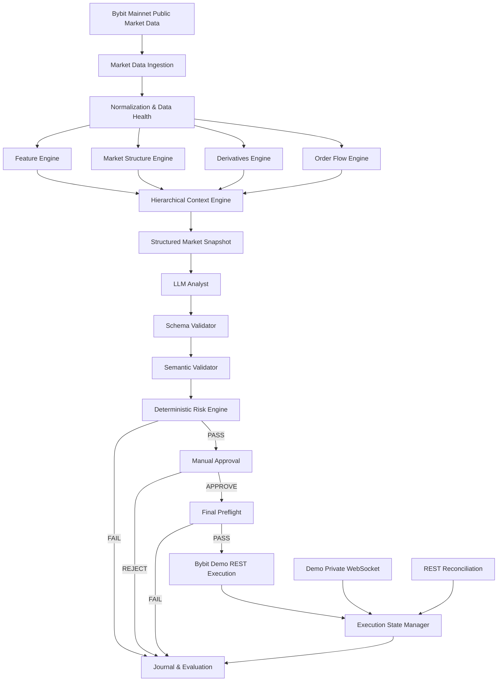
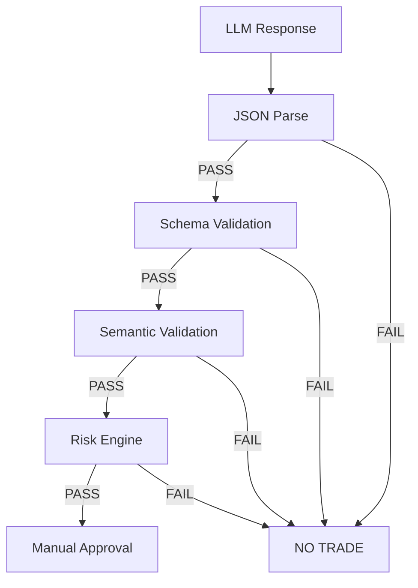
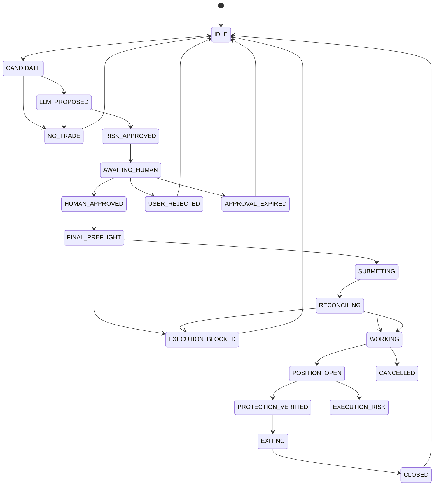
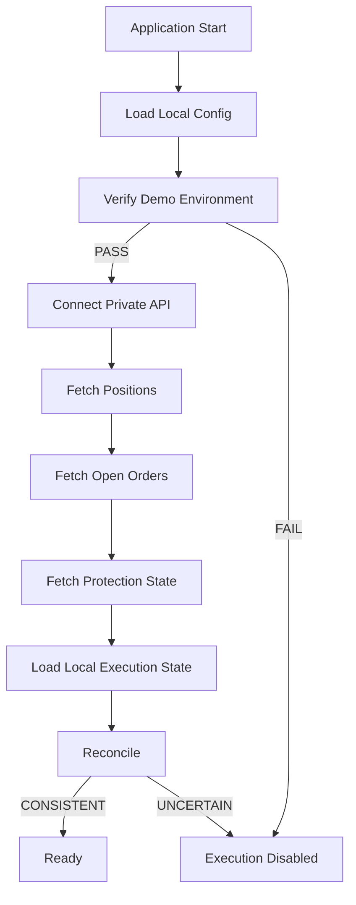

# System Design and Architecture

## 1. Purpose

This document defines the V1 architecture of the AI-Assisted Crypto Futures Trading System.

The design prioritizes:

* Clear separation of responsibilities
* Deterministic risk control
* Traceable decisions
* Fail-safe behavior
* Demo-only execution
* Minimal infrastructure
* Recoverable execution state

V1 trades only:

```text
BTCUSDT Perpetual
```

Execution environment:

```text
Bybit Demo Trading
```

---

# 2. Architectural Principles

The architecture shall follow these principles:

1. Public market-data collection and authenticated execution are separate.
2. Market calculations are deterministic.
3. The LLM receives structured market context rather than uncontrolled raw streams.
4. The LLM produces proposals, not orders.
5. Schema validation and semantic validation occur before risk validation.
6. The deterministic risk engine has final risk authority.
7. Manual approval is required before every entry.
8. Human approval cannot override deterministic risk rejection.
9. Final market/account validation occurs after human approval.
10. Every order has explicit lifecycle state.
11. Unknown or stale critical state results in `NO_TRADE`.
12. Exchange state is authoritative for execution reconciliation.

---

# 3. High-Level Architecture



---

# 4. Environment Architecture

The application uses two separate Bybit environments for different purposes.

```text
                    V1 APPLICATION
                          │
            ┌─────────────┴─────────────┐
            │                           │
            ▼                           ▼
BYBIT MAINNET PUBLIC DATA        BYBIT DEMO ACCOUNT
            │                           │
     No authentication          Demo credentials only
            │                           │
   Market REST + WS           REST execution + private WS
```

Public market data does not require authenticated production credentials.

The application shall not contain an authenticated mainnet trading client in V1.

---

# 5. Major Components

## 5.1 Market Data Layer

Responsibilities:

* Connect to Bybit public REST API
* Connect to Bybit public WebSocket
* Fetch historical candles
* Receive live candles
* Receive public trades
* Maintain the order book
* Receive liquidation events
* Retrieve slower derivatives data

Outputs shall be normalized before they are consumed by analysis modules.

---

## 5.2 Data Normalization Layer

Responsibilities:

* Standardize symbols
* Standardize numerical types
* Preserve exchange timestamps
* Store local receipt timestamps
* Normalize candle structures
* Normalize trade events
* Normalize liquidation events
* Normalize derivative observations

Conceptual event:

```python
NormalizedEvent(
    source="bybit",
    environment="mainnet_public",
    symbol="BTCUSDT",
    event_type="...",
    exchange_ts_ms=...,
    matching_engine_ts_ms=...,
    local_receive_ts=...,
    sequence=...,
    update_id=...,
    payload=...
)
```

The original exchange timestamp shall always remain available.

---

# 6. Data Health Layer

Every critical source shall expose a health state.

```text
HEALTHY
DEGRADED
STALE
UNKNOWN
```

Examples:

```text
candles_15m.health
candles_1h.health
candles_4h.health
orderbook.health
trade_stream.health
liquidation_stream.health
open_interest.health
long_short_ratio.health
private_execution_stream.health
```

A critical unhealthy component shall prevent new trade execution.

---

# 7. Candle Handling

The system shall maintain separate candles for:

```text
15m
1H
4H
```

Only confirmed closed candles shall be used for:

* Indicators
* Market structure
* Trend classification
* Entry eligibility

Conceptual flow:

```text
WebSocket Kline
      ↓
confirm == true?
      │
   ┌──┴──┐
   │     │
  No    Yes
   │     │
Context  Store Closed Candle
only     ↓
      Recalculate Features
```

---

# 8. Feature Engine

The Feature Engine performs deterministic calculations.

Initial V1 features include:

```text
EMA
RSI
ATR
Volume metrics
Volatility metrics
```

The engine shall never depend on LLM output.

Input:

```text
Validated closed candles
```

Output:

```text
TechnicalFeatureSet
```

---

# 9. Market Structure Engine

The Market Structure Engine identifies deterministic structural primitives.

Responsibilities:

```text
Swing highs
Swing lows
Higher Highs
Higher Lows
Lower Highs
Lower Lows
Basic trend state
Support zones
Resistance zones
Market regime features
```

The engine produces structured observations rather than natural-language trading advice.

Example:

```json
{
  "timeframe": "1h",
  "trend": "BULLISH",
  "last_structure_event": "HIGHER_HIGH",
  "nearest_support": 0,
  "nearest_resistance": 0
}
```

---

# 10. Derivatives Engine

The Derivatives Engine manages:

```text
Open Interest
Open Interest change
Funding rate
Account-holder long ratio
Account-holder short ratio
Liquidation summaries
```

These features provide derivatives context.

They shall not individually become automatic trade signals.

Example output:

```json
{
  "open_interest": {
    "current": 0,
    "change_pct": 0
  },
  "funding": {
    "rate": 0
  },
  "positioning": {
    "long_ratio": 0,
    "short_ratio": 0
  }
}
```

---

# 11. Order Flow Engine

The Order Flow Engine processes the Bybit-visible microstructure.

Initial V1 features may include:

```text
Spread
Spread in basis points
Top-N book imbalance
Depth within selected price distance
Aggressive buy volume
Aggressive sell volume
Signed volume imbalance
Liquidation activity
Liquidity concentration
Imbalance persistence
```

V1 begins with approximately:

```text
Order Book Depth = L50
```

The value shall remain configurable.

---

# 12. Local Order Book

Order-book state shall be managed independently from the decision engine.

```text
Connect
   ↓
Receive Snapshot
   ↓
Build Local Book
   ↓
Receive Delta
   ↓
Apply Update
   ↓
Validate State
```

If continuity becomes uncertain:

```text
Order Book
     ↓
INVALID
     ↓
NO NEW TRADES
     ↓
Rebuild
     ↓
Health Validation
     ↓
HEALTHY
```

The system shall never guess missing order-book state.

---

# 13. Hierarchical Context Engine

This engine organizes deterministic outputs into a consistent analysis hierarchy.

```text
MARKET CONTEXT
│
├── Market Regime
│
├── 4H Higher-Timeframe Context
│
├── 1H Market Structure
│
└── Key Price Levels

SETUP
│
├── 15m Setup
├── Volatility
└── Attainable Risk / Reward

CONFIRMATION
│
├── Open Interest
├── Funding
├── Positioning
├── Liquidations
├── Trade Imbalance
└── Order-Book Imbalance
```

This separation prevents every available feature from automatically becoming a mandatory signal.

---

# 14. Structured Market Snapshot

The LLM shall receive one compact structured market snapshot.

Example:

```json
{
  "snapshot_id": "btc-...",
  "symbol": "BTCUSDT",
  "decision_time_utc": "...",

  "data_quality": {
    "critical_ok": true,
    "orderbook_health": "HEALTHY",
    "trade_stream_health": "HEALTHY"
  },

  "timeframes": {
    "4h": {
      "trend": "BULLISH",
      "regime": "TRENDING"
    },

    "1h": {
      "structure": "HH_HL"
    },

    "15m": {
      "setup_state": "RETEST"
    }
  },

  "derivatives": {
    "open_interest": {},
    "funding": {},
    "account_positioning": {},
    "liquidations": {}
  },

  "order_flow": {
    "spread_bps": 0,
    "depth_imbalance": 0,
    "aggressive_buy_volume": 0,
    "aggressive_sell_volume": 0
  }
}
```

The LLM shall not be expected to reconstruct indicators or an order book from raw event streams.

---

# 15. LLM Analyst

The LLM acts only as a bounded analyst.

Allowed output:

```text
LONG
SHORT
NO_TRADE
```

It may also propose:

```text
Setup quality
Supporting evidence
Contradicting evidence
Entry
Stop Loss
Take Profit
Reasoning
Invalidation conditions
```

The LLM shall not determine:

```text
Final position quantity
Final risk budget
Daily loss limit
Account permissions
Execution environment
Whether risk rejection may be ignored
```

---

# 16. LLM Isolation

The LLM module shall not receive any reference to the authenticated exchange execution client.

Conceptually:

```text
LLM MODULE
    │
    ├── Can read structured snapshot
    └── Can return proposal

EXECUTION CLIENT
    │
    └── Not accessible from LLM module
```

This makes direct AI-driven exchange execution impossible by architecture.

---

# 17. LLM Output Validation

LLM output shall pass four stages.



Schema-valid does not mean trade-valid.

---

# 18. Semantic Validator

The Semantic Validator checks objectively valid trade geometry.

LONG:

```text
Stop Loss < Entry < Take Profit
```

SHORT:

```text
Take Profit < Entry < Stop Loss
```

It shall also verify:

```text
Finite numbers
Valid price steps
Reasonable distance from current market
Required values present
Proposal has not expired
Symbol is BTCUSDT
```

---

# 19. Risk Engine

The Risk Engine is independent of the LLM.

Input:

```text
Validated Trade Proposal
+
Current Market State
+
Current Demo Account State
+
Versioned Risk Configuration
```

Output:

```json
{
  "approved": true,
  "reason_codes": []
}
```

or:

```json
{
  "approved": false,
  "reason_codes": [
    "RR_BELOW_MINIMUM"
  ]
}
```

---

# 20. Risk Engine Responsibilities

The engine validates:

```text
Stop Loss exists
Stop geometry valid
Risk budget valid
Position size
Reward-to-risk
Daily loss limit
Existing position
Existing order
Concurrent entry intent
Market freshness
Account-state certainty
Quantity step
Minimum quantity
Maximum allowed quantity
```

It shall work without an LLM.

---

# 21. Manual Approval Layer

Only proposals that pass the Risk Engine reach manual approval.

Example:

```text
BTCUSDT

Decision: LONG
Setup Quality: HIGH

Entry: ...
Stop Loss: ...
Take Profit: ...

Risk: ...
Reward / Risk: ...

Supporting Evidence:
- ...
- ...

Contradicting Evidence:
- ...

Risk Engine: PASS

Approve trade? [Y/N]
```

`N` ends the trade attempt.

`Y` does not immediately mean order submission.

It proceeds to Final Preflight.

---

# 22. Approval TTL

Human approval shall expire after a configurable period.

Concept:

```text
Proposal Generated
       ↓
Risk Approved
       ↓
Human Approved
       ↓
Approval Timer
       ↓
Expired?
 │             │
Yes            No
 │             │
NO TRADE   Final Preflight
```

A materially changed market condition may also invalidate approval before TTL expiry.

---

# 23. Final Preflight

Immediately before execution, the system performs another deterministic validation.

Checks include:

```text
Demo environment confirmed
BTCUSDT confirmed
Market data healthy
Approval valid
Price still acceptable
Account reachable
Position state expected
Open orders expected
Risk still valid
Execution state idle
```

Failure:

```text
EXECUTION BLOCKED
```

---

# 24. Execution Architecture

Orders are submitted through:

```text
Bybit Demo REST
```

Execution state is monitored through:

```text
Demo Private WebSocket
+
REST Reconciliation
```

REST acknowledgement alone shall not be treated as final execution status.

---

# 25. Local Intent Before Exchange Submission

Before calling the exchange:

```text
Create intent_id
      ↓
Persist intent
      ↓
Generate unique orderLinkId
      ↓
Set execution state
      ↓
Submit REST request
```

The local system therefore knows that an execution attempt existed even if the network fails after submission.

---

# 26. Order Idempotency

Conceptual identifiers:

```text
decision_id
     ↓
intent_id
     ↓
orderLinkId
     ↓
Bybit orderId
```

If submission times out:

```text
TIMEOUT
   ↓
DO NOT BLINDLY RETRY
   ↓
Query using known identifiers
   ↓
Order exists?
   │
 ┌─┴─┐
Yes  No
 │    │
Track Controlled Resubmit
```

---

# 27. Trade Lifecycle State Machine



---

# 28. Execution State Manager

The Execution State Manager is responsible for:

```text
Current trade lifecycle state
Intent ID
Order ID
OrderLinkId
Fill quantity
Average fill price
Protection state
Position state
Recovery state
```

Only valid state transitions shall be accepted.

---

# 29. Exchange-Side Protection

An entry is not operationally complete until protection has been verified.

Concept:

```text
Entry Filled
     ↓
Verify Stop Loss
     ↓
Protection Exists?
   ┌────┴────┐
  Yes        No
   │          │
Normal   EXECUTION_RISK
```

If protection is uncertain:

```text
No new entries
Reconcile exchange state
Restore/verify protection
Log incident
```

---

# 30. Startup Recovery

Program startup shall not assume a clean account.



---

# 31. WebSocket Recovery

Public or private WebSocket loss shall immediately affect system health.

```text
WS Disconnect
      ↓
Relevant Health = UNHEALTHY
      ↓
Block New Entries
      ↓
Reconnect With Backoff
      ↓
Rebuild Required State
      ↓
Warm Rolling Features
      ↓
Validate Freshness
      ↓
HEALTHY
```

---

# 32. Persistence Architecture

V1 uses local storage.

```text
data/
│
├── market/
│   ├── trades/
│   ├── orderbook/
│   └── liquidations/
│
logs/
│
├── decisions/
├── execution/
└── system/
```

Formats:

```text
CSV
JSON / JSONL
```

CSV is useful for evaluation tables.

JSON/JSONL is useful for nested market snapshots and detailed decision/execution events.

---

# 33. Logging Pipeline

```text
Market Snapshot
      ↓
Decision Record
      ↓
LLM Record
      ↓
Validation Result
      ↓
Risk Result
      ↓
Approval Result
      ↓
Execution Events
      ↓
Trade Outcome
```

Every executed trade shall be reconstructable from logs.

---

# 34. Module Boundaries

Recommended V1 source structure:

```text
ai-futures-trader/
│
├── main.py
│
├── market_data/
│   ├── rest_client.py
│   ├── public_ws.py
│   ├── candles.py
│   ├── orderbook.py
│   └── recorder.py
│
├── data_quality/
│   ├── freshness.py
│   ├── timestamps.py
│   └── health.py
│
├── indicators/
│   └── technical.py
│
├── market_structure/
│   ├── swings.py
│   ├── structure.py
│   └── levels.py
│
├── derivatives/
│   ├── open_interest.py
│   ├── funding.py
│   ├── positioning.py
│   └── liquidations.py
│
├── orderflow/
│   ├── imbalance.py
│   └── trade_flow.py
│
├── context_engine/
│   └── market_snapshot.py
│
├── decision_engine/
│   ├── llm_client.py
│   ├── schemas.py
│   └── validator.py
│
├── risk_manager/
│   ├── sizing.py
│   ├── rules.py
│   └── risk_engine.py
│
├── approval/
│   └── cli.py
│
├── executor/
│   ├── demo_client.py
│   ├── private_ws.py
│   ├── state_machine.py
│   └── reconciliation.py
│
├── journal/
│   ├── decision_logger.py
│   ├── trade_logger.py
│   └── metrics.py
│
├── config/
│   └── settings.py
│
├── tests/
│
├── docs/
│
├── data/
│
├── logs/
│
├── .env.example
├── .gitignore
├── requirements.txt
└── README.md
```

---

# 35. Dependency Direction

Modules shall depend downward toward data and deterministic services.

Conceptually:

```text
main
 ↓
orchestration
 ↓
analysis / decision / risk / execution
 ↓
domain modules
 ↓
Bybit adapters / local storage
```

Important rule:

```text
Risk Engine
    X
    │
    └── must not depend on LLM internals
```

and:

```text
LLM
    X
    │
    └── must not depend on DemoExecutionClient
```

---

# 36. Main Runtime Flow

Conceptual application loop:

```text
Start
 ↓
Validate Config
 ↓
Verify Demo Environment
 ↓
Recover Account State
 ↓
Connect Public Streams
 ↓
Warm Historical Data
 ↓
Build Features
 ↓
Wait Until Required Data Healthy
 ↓
Evaluate Trading Context
 ↓
Create Market Snapshot
 ↓
Ask LLM
 ↓
Validate Proposal
 ↓
Risk Engine
 ↓
Manual Approval
 ↓
Final Preflight
 ↓
Demo Execution
 ↓
Monitor Position
 ↓
Journal
 ↓
Repeat
```

---

# 37. Decision Evaluation Frequency

The V1 strategy-analysis layer shall primarily evaluate new entry opportunities around valid 15m decision points rather than reacting to every individual order-book update.

Fast streams such as:

```text
Trades
Order Book
Liquidations
```

shall be aggregated into short-window features that support the current decision context.

This prevents the LLM from being triggered for every market event.

---

# 38. Failure Boundaries

A failure in one component shall not automatically corrupt other components.

Examples:

```text
LLM unavailable
    → NO TRADE
    → market recording may continue

Public WS unavailable
    → NO TRADE
    → execution monitoring remains active

Journal failure during critical execution state
    → block new entries

Risk Engine unavailable
    → block execution

Private execution WS unavailable
    → reconcile via REST
    → no new entry until state certain
```

---

# 39. V1 Security Boundary

The V1 execution layer shall use only:

```text
BYBIT_DEMO_API_KEY
BYBIT_DEMO_API_SECRET
```

If an external LLM is used:

```text
LLM_API_KEY
```

Secrets shall be loaded from environment variables or `.env`.

They shall never appear inside:

```text
Source code
Git history
CSV files
JSON logs
Exception dumps
README examples
```

---

# 40. ADR — 001 Hybrid AI Decision Layer

## Decision

Use deterministic preprocessing plus a bounded LLM reasoning layer.

## Reason

Deterministic software handles reproducible calculations.

The LLM is used only for structured contextual reasoning.

## Rejected Alternatives

### Pure rules

Too restrictive for the intended LLM research component.

### Pure LLM

Insufficient deterministic control for execution and risk.

---

# 41. ADR — 002 Independent Risk Engine

## Decision

Risk management shall remain fully independent of the LLM.

## Reason

Risk calculations and hard limits are objective and testable.

The LLM shall not modify or override them.

---

# 42. ADR — 003 Mainnet Public Data + Demo Execution

## Decision

Use:

```text
Bybit Mainnet Public REST/WS
```

for market data and:

```text
Bybit Demo REST + Private WS
```

for authenticated execution.

## Reason

This provides live market information while preventing real-money V1 execution.

---

# 43. ADR — 004 Closed Candles for Strategy State

## Decision

Use confirmed closed candles for indicator, trend and market-structure calculations affecting entry eligibility.

## Reason

Incomplete candles may change before closure and produce unstable analysis.

---

# 44. ADR — 005 Exchange-Side Protection

## Decision

Executed positions must have verified exchange-side protective state.

## Reason

Risk protection must not depend solely on the local Python process remaining online.

---

# 45. ADR — 006 Idempotent Execution

## Decision

Each execution intent shall use persistent local identifiers and unique exchange order identifiers.

## Reason

Network uncertainty must not produce duplicate orders.

---

# 46. ADR — 007 Fail-Closed Data Quality

## Decision

Critical stale, unknown or invalid state shall produce:

```text
NO_TRADE
```

## Reason

For V1, avoiding uncertain execution is more important than capturing every possible trading opportunity.

---

# 47. ADR — 008 Local Storage for V1

## Decision

Use CSV and JSON/JSONL rather than PostgreSQL.

## Reason

V1 uses one symbol and runs locally.

A database would add unnecessary infrastructure at this stage.

---

# 48. Deferred Architecture

The following are intentionally postponed:

```text
Cloud deployment
Docker
Kubernetes
PostgreSQL
Web dashboard
Multi-symbol architecture
Cross-exchange order flow
Fully automated execution
Real-money execution
Advanced spoofing detection
Deep order-book ML
```

These may be reconsidered only after V1 evaluation.

---

# 49. Architecture Invariants

The following rules must always remain true in V1:

```text
LLM cannot execute orders.

LLM cannot override risk rejection.

Human cannot override risk rejection.

Production trading credentials do not exist.

Unknown critical state blocks execution.

Order submission is idempotent.

Program restart requires exchange reconciliation.

Every open trade requires verified protection.

Every executed trade is journaled.

NO_TRADE is a valid normal outcome.
```

---

# 50. Final Architecture

```text
BYBIT MAINNET PUBLIC DATA
          ↓
MARKET DATA INGESTION
          ↓
NORMALIZATION
          ↓
DATA HEALTH / FRESHNESS
          ↓
TECHNICAL FEATURES
MARKET STRUCTURE
DERIVATIVES
ORDER FLOW
          ↓
HIERARCHICAL CONTEXT ENGINE
          ↓
STRUCTURED MARKET SNAPSHOT
          ↓
LLM ANALYST
          ↓
SCHEMA VALIDATION
          ↓
SEMANTIC VALIDATION
          ↓
INDEPENDENT RISK ENGINE
          ↓
MANUAL APPROVAL
          ↓
FINAL PREFLIGHT
          ↓
BYBIT DEMO REST EXECUTION
          ↓
PRIVATE WS + REST RECONCILIATION
          ↓
EXECUTION STATE MANAGER
          ↓
EXCHANGE-SIDE PROTECTION
          ↓
TRADE JOURNAL / EVALUATION
```

This architecture is the baseline V1 design and should remain stable unless a later implementation or integration test reveals a concrete technical reason to change it.

---

# 18. Phase 15 Implemented Architecture Snapshot

The implemented V1 baseline now uses a testable orchestration layer rather than duplicating control flow inside the production runner.

```text
MarketDataRunner
      ↓
Market Context Provider
      ↓
Decision Provider
      ↓
TradingPipeline
      ↓
Risk Provider
      ↓
Execution Safety Provider
      ↓
Approval Provider
      ↓
Execution Request Provider
      ↓
Execution Coordinator
      ↓
JournalRunLifecycle
```

Key implemented modules / responsibilities include:

- `market_data/` — REST / WebSocket acquisition, health, freshness, and recording
- technical / structure modules — deterministic indicators and market structure
- `context_engine/` — structured market context
- decision layer — bounded Groq LLM proposal generation and validation
- risk layer — deterministic position sizing and rule enforcement
- approval layer — exact manual `APPROVE` gate
- execution layer — Demo preflight, deterministic order identity, reconciliation, and duplicate prevention
- `orchestration/pipeline.py` — integrated V1 pipeline
- `journal/` — persistent lifecycle logging and integrity validation
- `evaluation/` — system metrics, closed-trade metrics, outcome import, and equity-curve tooling
- `system_checks/` — security audit

The production runner delegates orchestration to `TradingPipeline`, which is also covered by integration tests.

## 18.1 Execution Safety Default

```env
ENABLE_DEMO_EXECUTION=false
```

Execution is therefore disabled by default even when market analysis produces a risk-approved proposal.

## 18.2 Phase 15 Baseline

```text
Branch:
feature/system-integration-testing

Commit:
9a18e050f68aa311f4ca4a7628384eee6aec21af

Tag:
phase15-stability-baseline
```

The architecture above is frozen for the current Phase 15 stability window unless a critical defect requires a new baseline.
